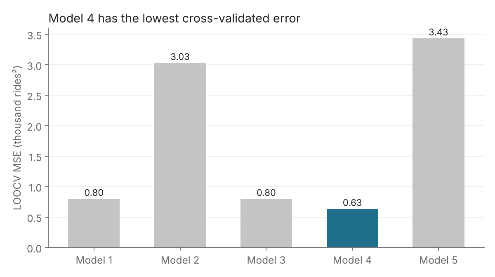
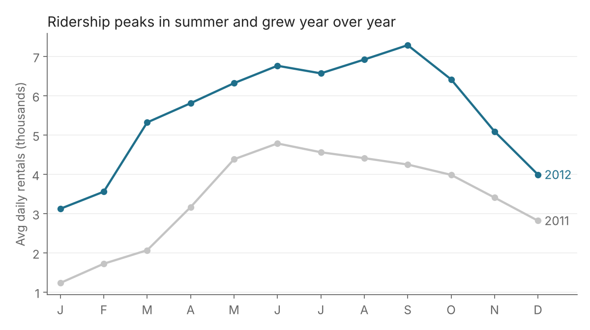
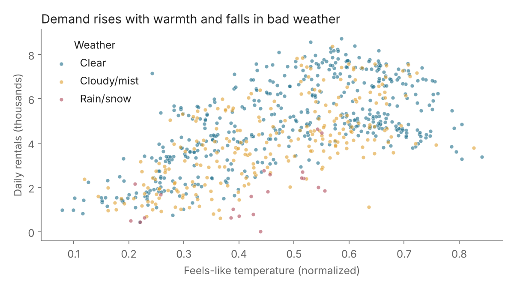

# Predicting Daily Bike Rental Demand with Regression

Which combination of calendar and weather variables best predicts how many bikes people rent each day? This project compares five linear regression models using validation-set, leave-one-out (LOOCV), 5-fold and 10-fold cross-validation.

**Tools:** R (`lm`, `glm`, `boot::cv.glm`) · **Course:** Predictive Analytics, Stockton University · **Slides:** [`docs/Predictive_Analytics_Presentation.pptx`](docs/Predictive_Analytics_Presentation.pptx)

## Key findings

- **Model 4 predicts best.** It adds squared terms for feel-like temperature and humidity, and it had the lowest error under every validation method (LOOCV MSE 0.63 vs 0.80 for the full linear model).
- **Weather and season drive demand.** Season, year, weekday, weather situation, humidity and windspeed were significant (p < 0.05) in the full model. Bad weather, high humidity and high wind all reduce rentals.
- **Ridership grew from 2011 to 2012.** Average daily rentals rose from about 3.4k to 5.6k.
- **Weather alone is not enough.** The single-predictor model (weather only) had the worst error, more than 5x higher than Model 4.



| Model | Predictors | Validation MSE | LOOCV MSE | 5-fold CV | 10-fold CV |
|---|---|---|---|---|---|
| 1 | All variables (linear) | 0.7562 | 0.7981 | 0.8158 | 0.7999 |
| 2 | Month, weather, humidity, windspeed | 2.9003 | 3.0306 | 3.0091 | 3.0318 |
| 3 | All + windspeed×humidity + temp×weather | 0.7663 | 0.7980 | 0.7983 | 0.8125 |
| **4** | **All + feel-like temp² + humidity²** | **0.6154** | **0.6345** | **0.6441** | **0.6399** |
| 5 | Weather situation only | 3.2531 | 3.4343 | 3.4500 | 3.4343 |

MSE is in (thousands of rides)². Validation MSE comes from the project presentation (100 random 70/30 splits). LOOCV values were independently re-verified.

<p>


</p>

## Data

[UCI Bike Sharing Dataset](https://archive.ics.uci.edu/dataset/275/bike+sharing+dataset), daily Capital Bikeshare rentals for 2011-2012 (731 days). `data/bike_sharing_daily.csv` is a trimmed copy: date, holiday, and the casual/registered split were removed, leaving 10 predictors and the response `cnt` (total rides, divided by 1000 in the script).

| Variable | Meaning |
|---|---|
| season, yr, mnth, weekday | Calendar (yr: 0 = 2011, 1 = 2012) |
| workingday | 1 if not a weekend or holiday |
| weathersit | 1 clear, 2 cloudy/mist, 3 light rain/snow |
| temp, atemp, hum, windspeed | Normalized weather measures |
| cnt | Total daily rentals (response) |

## Reproduce it

```bash
git clone https://github.com/<your-username>/bike-sharing-demand-regression.git
cd bike-sharing-demand-regression
Rscript R/bike_sharing_regression.R   # needs the R package: boot
```

The script prints the model comparison table, writes `outputs/model_comparison.csv`, and saves a chart. K-fold results use a fixed seed.

## Repository layout

```
data/      bike_sharing_daily.csv
R/         bike_sharing_regression.R
docs/      project presentation (.pptx)
outputs/   model_comparison.csv (after running) and figures
```

## Limitations and next steps

- `season`, `weathersit`, `mnth` and `weekday` are coded as numbers, so the models treat them as ordered quantities. Converting them to factors is the obvious next improvement.
- Observations are consecutive days, so random train/test splits can leak information between neighbouring days. A time-based split would be a stricter test.
- Try regularization (ridge/lasso) or tree-based models and compare against Model 4.

## Team

Tyler Tarabocchia, Ryan Guidotti and Joe Nasr.
